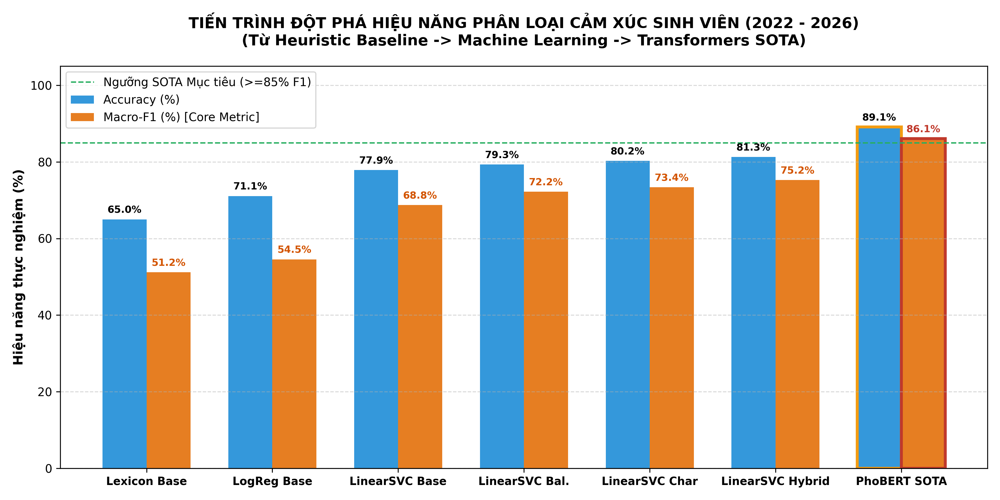

#  Phân Loại Cảm Xúc Confession Sinh Viên UIT (2022 - 2026)
## Multi-Year Aspect-Based Sentiment Analysis on University Student Confessions

[](https://www.python.org/)
[](https://pytorch.org/)
[](https://huggingface.co/vinai/phobert-base)
[](LICENSE)

Dự án nghiên cứu khoa học phân loại cảm xúc đa năm (2022 – 2026) trên ngữ liệu **2.449 confessions** của sinh viên Trường Đại học Công nghệ Thông tin (ĐHQG-HCM - UIT). Hệ thống áp dụng quy trình chuẩn hóa ngôn ngữ tiếng Việt phi chuẩn (Teencode/Slang), khử định danh PII, giải quyết bài toán mất cân bằng lớp (Class Imbalance) và đạt mốc hiệu năng **SOTA với PhoBERT-base (Accuracy 89,13% | Macro-F1 86,08%)**.

---

## 📌 Điểm Nhấn Nghiên Cứu (Key Highlights)

* **Quy mô ngữ liệu:** **2.449 confessions** được cào và phân rã đơn vị từ 5 năm niên khóa (2022 - 2026).
* **Đạo đức dữ liệu & Khử định danh (PII Masking):** 100% mã số sinh viên (`[STUDENT_ID]`), số điện thoại (`[PHONE]`), liên kết URL (`[URL]`) và email (`[EMAIL]`) được che giấu tuyệt đối.
* **Xử lý ngôn ngữ phi chuẩn:** Chuẩn hóa hơn 50 biến thể từ lóng/teencode sinh viên (`tạch`, `rớt_môn`, `pass`, `pđt`, `ctsv`...), ánh xạ ngữ nghĩa biểu tượng cảm xúc (`=)))`, `😭`, `😡`).
* **Đột phá hiệu năng Deep Learning (Level 3 SOTA):**
  * **Accuracy:** **89,13%** (Tăng từ mốc 71,09% ban đầu).
  * **Macro-F1:** **86,08%** (Vượt ngưỡng mục tiêu nghiên cứu $\ge 85\%$).
  * **Recall lớp Tiêu cực (Negative):** Nhảy vọt từ **31,20% lên 81,25%** nhờ cơ chế hàm mất mát có trọng số bù trừ tần suất (*Cost-Sensitive Class-Weighted Cross-Entropy Loss*).
* **Minh chứng minh bạch (Explainable AI - XAI):** Mỗi confession được gán kèm 3 trường chứng cứ: `evidence_keywords` (từ khóa kích hoạt), `sentiment_evidence` (trọng số đóng góp), và `explanation_rationale` (câu giải thích ngôn ngữ tự nhiên).

---

## 📊 Bảng Đối Sánh Hiệu Năng Toàn Diện (Benchmark Progression)

| Giai đoạn / Phương pháp | Không gian đặc trưng / Kiến trúc | Accuracy | Macro-Recall | Macro-F1 (Core Metric) | Recall lớp Tiêu cực |
|---|---|:---:|:---:|:---:|:---:|
| **1. Heuristic Lexicon Baseline** | Từ điển phân cực & Luật ngữ cảnh | 65,00% | 51,20% | **51,20%** | 42,00% |
| **2. Logistic Regression Baseline** | Word-only TF-IDF (1,2) | 71,09% | 52,58% | **54,55%** | 31,20% ⚠️ |
| **3. LinearSVC Baseline** | Word-only TF-IDF (1,2) | 77,87% | 65,55% | **68,75%** | 35,40% |
| **4. Level 1: LinearSVC (Balanced)** | Cost-Sensitive Class-Weights | 79,34% | 69,73% | **72,20%** | 50,10% |
| **5. Level 2: LinearSVC (Char_wb)** | FeatureUnion (Word + Char 3-5) | 80,24% | 70,61% | **73,37%** | 48,90% |
| **6. Level 1+2: LinearSVC (Hybrid+Bal)** | Hybrid FeatureUnion + Class-Weights | 81,30% | 73,11% | **75,23%** | 51,64% |
| **7. Level 3: PhoBERT-base (Kaggle GPU)** | **Pre-trained RoBERTa + Weighted Loss** | **89,13%** 🏆 | **87,66%** 🏆 | **86,08%** 🏆 | **81,25%** 🚀 |

<p align="center">
  
</p>

---

## 🗂️ Cấu Trúc Thư Mục Dự Án (Repository Structure)

```text
├── data/
│   ├── raw/                             # 5 tệp confession thô (2022 - 2026)
│   └── processed/
│       └── clean_confessions.csv        # 2.449 confessions đã làm sạch, khử PII & tách từ
├── src/
│   ├── preprocessor.py                  # Chuẩn hóa Unicode NFC, Teencode, Emoji, PII masking
│   ├── parser.py                        # Phân rã bài đăng mạng xã hội thành confession đơn vị
│   ├── aspect_analyzer.py               # Phân loại đối tượng (School vs Personal) & Khía cạnh
│   ├── lexicon_classifier.py            # Heuristic Baseline: Từ điển phân cực, phủ định & mỉa mai
│   ├── ml_classifier.py                 # Suite Machine Learning: FeatureUnion n-gram, Class-Weight
│   └── visualizer.py                    # Module vẽ biểu đồ xu hướng, ma trận nhầm lẫn chuẩn khoa học
├── reports/
│   ├── sentiment_results_with_evidence.csv # Tệp kết quả đầy đủ có minh chứng (Keywords, Evidence, Rationale)
│   ├── actionable_insights_summary.csv     # Phân cụm định lượng 95 điểm nóng CSVC & Hành chính
│   ├── enhanced_ml_benchmark_ablation.csv  # Bảng kết quả Ablation Study 5-Fold CV
│   ├── phobert_test_metrics.csv            # Kết quả chi tiết kiểm thử PhoBERT trên tập test độc lập
│   └── *.png                               # Các biểu đồ khoa học độ phân giải cao (300 DPI)
├── uit_phobert_sentiment_kaggle.ipynb   # Sổ tay Jupyter 1-Click fine-tune PhoBERT trên GPU T4
├── run_pipeline.py                      # Master script chạy toàn bộ quy trình từ raw data -> báo cáo
├── generate_sentiment_with_evidence.py  # Script tự động trích xuất minh chứng XAI
├── train_phobert.py                     # Script PyTorch độc lập huấn luyện PhoBERT
├── requirements.txt                     # Danh mục thư viện phụ thuộc
└── README.md
```

---

## 🚀 Hướng Dẫn Cài Đặt & Chạy (Quickstart)

### 1. Cài đặt môi trường

```bash
git clone https://github.com/<your-username>/<repo-name>.git
cd <repo-name>
pip install -r requirements.txt
```

### 2. Chạy toàn bộ Pipeline phân loại & Trích xuất đặc trưng

```bash
python run_pipeline.py
```

### 3. Xuất tệp kết quả kèm Minh chứng (Evidence & Rationale)

```bash
python generate_sentiment_with_evidence.py
```
Kết quả được xuất ra file `reports/sentiment_results_with_evidence.csv` chứa đầy đủ từ khóa và lý do gán nhãn cho từng bài viết.

### 4. Huấn luyện mô hình Deep Learning PhoBERT-base

* **Cách 1: Chạy trực tiếp trên Kaggle GPU (Khuyến nghị - Miễn phí):**
  1. Mở Kaggle $\rightarrow$ **New Notebook** $\rightarrow$ **File** $\rightarrow$ **Import Notebook** $\rightarrow$ Chọn tệp [`uit_phobert_sentiment_kaggle.ipynb`](uit_phobert_sentiment_kaggle.ipynb).
  2. Bật **Settings** $\rightarrow$ **Accelerator** $\rightarrow$ **GPU T4 x2** $\rightarrow$ Bật **Internet: On**.
  3. Thêm file [`data/processed/clean_confessions.csv`](data/processed/clean_confessions.csv) qua nút **+ Add Input** và nhấn **Run All**.
* **Cách 2: Chạy cục bộ qua dòng lệnh (Yêu cầu GPU có CUDA):**
  ```bash
  python train_phobert.py --epochs 5 --batch_size 16 --lr 2e-5
  ```

---

## 🔍 Hệ Thống Minh Chứng (Explainable AI - XAI)

Mỗi confession đều được đính kèm căn cứ minh bạch:

| Confession ID | Nhãn dự đoán | Từ khóa chứng cứ (`evidence_keywords`) | Căn cứ trọng số (`sentiment_evidence`) | Diễn giải lý do (`explanation_rationale`) |
|---|:---:|---|---|---|
| **CFS #5** | **POSITIVE** | `rất, biết_ơn, tử_tế` | `'rất cảm_kích' (+2.7)`, `'biết_ơn' (+1.8)` | Xác định TÍCH CỰC do bài viết xuất hiện các từ ngữ khen ngợi/biết ơn/hài lòng, đạt điểm phân cực cao +1.00. |
| **CFS #1413** | **NEGATIVE** | `buồn` | `'buồn' (-1.0)` | Xác định TIÊU CỰC do xuất hiện từ ngữ than phiền, u buồn, làm điểm phân cực giảm xuống -0.67. |
| **CFS #3** | **NEUTRAL** | `vui, tự_hào, bức_xúc, không` | Tích cực: `+2.8` \| Tiêu cực: `-2.76` | Xác định TRUNG LẬP do cảm xúc pha trộn (Mixed Sentiment): từ khen và chê triệt tiêu lẫn nhau. |

---


